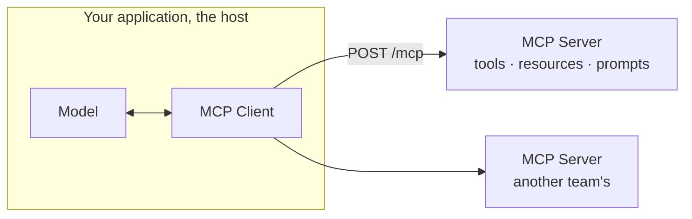
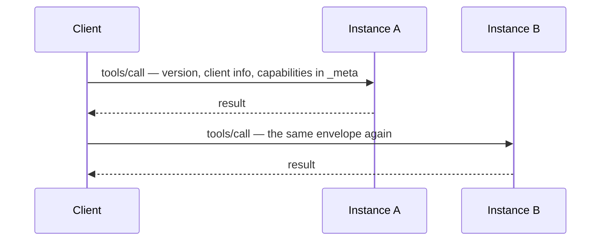

# TypeScript MCP Workshop, specification 2026-07-28

Sixteen runnable examples covering the Model Context Protocol as the 2026-07-28
revision defines it: a stateless request/response protocol. Each request
describes itself, so it can land on any server instance, and the exchanges that
used to need a held-open bidirectional stream no longer do.

> **Version.** Everything here targets the `2026-07-28` revision and is checked
> against [`schema/2026-07-28/schema.ts`](https://github.com/modelcontextprotocol/modelcontextprotocol/blob/main/schema/2026-07-28/schema.ts),
> which is the arbiter wherever prose and schema disagree. Coming from
> `2025-11-25`? Start with [the migration table](docs/migration.md).

Everything uses the official TypeScript SDK v2, the scoped packages
(`@modelcontextprotocol/server`, `/client`, `/node`) that replaced the
monolithic `@modelcontextprotocol/sdk`. Where a module turns on something the
revision added, its README names and links the SEP.

## The proof, as a page

The release notes show the stateless change as a picture. A picture was true the
day someone drew it and will never tell you when it stops being true.

All sixteen modules carry one. `src/08-stateless-core/stateless.story.ts` draws
the same before/after diagrams as the release notes and then earns them: two
real instances, a real round-robin balancer with no affinity, and assertions
that fail if any request needs a particular backend. Make the balancer sticky
and two of the three stories go red.

Each story imports the module's real `buildServer` rather than a copy, so a
story that passes is a statement about the module and not about a
reimplementation of it. Several were written against what the modules *should*
do and corrected against what they actually do — 01 has the isError-versus
-32601 distinction the other way round from how I first assumed it.

```bash
pnpm test:story     # 45 stories across 16 modules, writes reports/index.html
```

Stories live in `*.story.ts` and run on Vitest; `*.test.ts` stays with
`node:test` under `pnpm test`. None of them need an API key: the demos use a
model to drive tool calls, the stories drive the protocol directly. CI runs both
suites on every pull request and publishes the report to Pages on every push to
`main`.

**[Read the report →](https://jagreehal.github.io/typescript-mcp-workshop/)**

## Prerequisites

- Node.js 22 or newer (the SDK needs 20)
- pnpm
- A model: an API key for Mistral, Groq or OpenAI, or [Ollama](https://ollama.ai) running locally

```bash
pnpm install
pnpm setup          # environment check
```

Put your key in `.env` and pick a provider in [`src/model.ts`](src/model.ts).
Ten of the sixteen modules exercise the protocol without a model, so they run
with no key at all.

## How MCP fits together



Three roles. A **server** exposes tools, resources and prompts. A **client**
speaks the protocol to one server. The **host** is your application: it owns
the model, runs a client per server, and decides what the model may call.
Nothing in the protocol connects two servers to each other, which is why
[module 05](src/05-multi-server) has the model chaining them instead.

On this revision every request stands alone. No handshake, no session, so the
arrow above can point at any instance of the server:



## The examples

Each module gives you a `server.ts` and a `client.ts` to run in two terminals,
or one combined script.

| # | Module | What it shows | Model key |
|---|---|---|---|
| 01 | [tools-only](src/01-tools-only) | `registerTool`, structured output, the per-request server factory | yes |
| 02 | [resources](src/02-resources) | URI-addressed read-only data, templates, cache hints, pagination | no |
| 03 | [prompts](src/03-prompts) | User-chosen templates with completable arguments | yes |
| 04 | [stdio-filesystem](src/04-stdio-filesystem) | Real stdio, host wiring, and the process boundary as the security model | yes |
| 05 | [multi-server](src/05-multi-server) | One agent, two servers, prefixed namespaces, failure isolation | yes |
| 06 | [auth-api-key](src/06-auth-api-key) | Bearer keys, and how identity reaches a handler | no |
| 07 | [playwright-demo](src/07-playwright-demo) | A live v1-SDK server, and `auto` falling back to the 2025 era | yes |
| 08 | [stateless-core](src/08-stateless-core) | Two instances, round-robin, one conversation. State as an explicit handle | no |
| 09 | [oauth-authentication](src/09-oauth-authentication) | OAuth 2.1 hardened: `iss`, CIMD, and step-up on `insufficient_scope` | no |
| 10 | [mrtr](src/10-mrtr) | Handlers as resumable state machines, `input_required` in place of a stream | yes |
| 11 | [headers-and-cache](src/11-headers-and-cache) | A gateway that blocks, meters and shards from headers alone | no |
| 12 | [observability](src/12-observability) | Distributed tracing through `_meta` with autotel | no |
| 13 | [subscriptions](src/13-subscriptions) | `subscriptions/listen`, plus request-scoped progress and cancellation | no |
| 14 | [tasks](src/14-tasks) | Long-running work as a durable handle, and where the tasks extension stands | no |
| 15 | [mcp-apps](src/15-mcp-apps) | A tool that ships a user interface, sandboxed and rendered by the host | no |
| 16 | [testing](src/16-testing) | A real client over an in-memory transport, and no test framework | no |

```bash
pnpm example:01          # server and client together
pnpm example:server:01   # or separately, in two terminals
pnpm example:client:01
```

Module 04 spawns its own server, so `pnpm example:04` is the whole thing.
Module 11 needs three processes and `pnpm example:11` starts all of them.
Module 15 adds `pnpm example:15:host`, which renders its View in a browser.

## Tooling

```bash
pnpm test      # module 16's suite, through node --test. No framework, no config.
pnpm inspect   # the MCP Inspector, pointed at any module's endpoint
pnpm lint
```

The [Inspector](https://github.com/modelcontextprotocol/inspector) is the
fastest way to see what a server actually exposes. Start any module's server,
run `pnpm inspect`, and connect to its `/mcp` URL.

## Shared code

Five short files under [`src/shared`](src/shared) that the modules lean on.
Read them before the modules:

- [`serve.ts`](src/shared/serve.ts): `createMcpHandler` plus a Node HTTP server, with the `Host` and `Origin` guards and an `authenticate` hook.
- [`connect.ts`](src/shared/connect.ts): a `Client` with `versionNegotiation`, declared capabilities, and a retry for when the sibling server is still booting.
- [`store.ts`](src/shared/store.ts): the state the protocol stopped keeping. Async and TTL'd on purpose, so becoming Redis is one line. Modules 08 and 14 both mint handles against it.
- [`ai-tools.ts`](src/shared/ai-tools.ts): `tools/list` mapped to AI SDK tools. Twenty lines, and it covers what "give the model your MCP tools" means.
- [`otel.ts`](src/shared/otel.ts): OpenTelemetry setup for module 12.

## Suggested order

**Fundamentals (01 to 05)**: tools, resources, prompts, transports, composition.
Same ground as the previous edition, rebuilt on the protocol itself instead of
a wrapper library.

**Boundaries (06, 07, 09)**: identity, third-party servers, OAuth.

**New material (08, 10, 11, 12, 13, 14, 15)**: the 2026-07-28 revision proper.
If you already know MCP and want only what changed, start at 08.

**Before you ship (16)**: tests, then [the threat checklist](docs/security.md).

## Where this stops

The workshop covers the protocol and the seams around it. Your database schema,
your migrations and your row-level security sit behind those seams, and none of
them change anything above. That boundary is deliberate: a Postgres tutorial
with MCP on top dates faster than the protocol does.

Two places where the line is finer than it sounds. Multi-tenancy has a
protocol-facing half, and [module 11](src/11-headers-and-cache) covers it:
`Mcp-Param-Tenant-Id` promoted to a header, checked against the body argument,
`-32020` when they disagree, and a gateway sharding on it without parsing a
JSON body. Isolating one tenant's rows from another's is your schema's job.
State is the same shape: [`shared/store.ts`](src/shared/store.ts) is the
interface modules 08 and 14 mint handles against, with a TTL and a swap point,
and what you put behind it is yours.

Four pages under [`docs/`](docs) cut across the modules:

- [Migration from 2025-11-25](docs/migration.md), every change mapped to a module
- [Threats, and which module answers each](docs/security.md)
- [SDK v2 notes](docs/sdk-notes.md), the gaps and surprises, each with how it was checked
- [Deploying a stateless server](docs/deployment.md)

Upstream:

- [The specification](https://modelcontextprotocol.io/specification/2026-07-28) and its [changelog](https://modelcontextprotocol.io/specification/2026-07-28/changelog)
- [The schema](https://github.com/modelcontextprotocol/modelcontextprotocol/blob/main/schema/2026-07-28/schema.ts)
- [The conformance suite](https://github.com/modelcontextprotocol/conformance)

## Troubleshooting

| Symptom | Cause | Fix |
|---|---|---|
| `EADDRINUSE` | A previous run still holds the port | Kill it. One port per module, 8082 to 8100 |
| `-32602` naming a `_meta` field | Something sent a 2026-07-28 request without the envelope | Use the SDK client, or add the envelope by hand |
| `SdkError(EraNegotiationFailed)` | The client pinned `2026-07-28`, the server speaks 2025 only | Use `era: 'auto'` — module 07 |
| `-32601` on `completion/complete` | `.describe()` chained after `completable()` | Put it inside. Module 03 explains why |
| The client hangs on connect | The sibling server has not started | `connectWhenReady` retries; check the server terminal for a crash |
| Garbage on a stdio connection | A `console.log` went to stdout | Log to stderr. Module 04 explains why |

## Ports

The workshop uses 8082 to 8100 on loopback. Servers bind `127.0.0.1` and fail
loudly on a conflict, so you get `EADDRINUSE` instead of half a dual-stack
bind and a confusing protocol error later. Set `MCP_BIND_HOST=0.0.0.0` to
listen everywhere, which is what the [`Dockerfile`](Dockerfile) does.

## Licence

GPL-3.0-only. © Jag Reehal.
