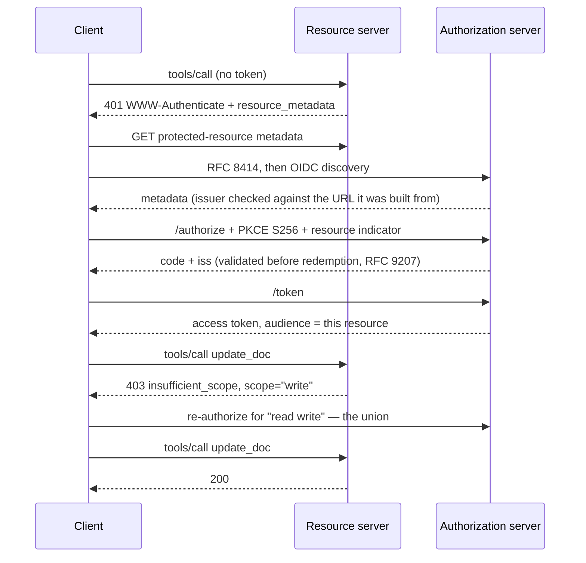

# 09. OAuth 2.1, hardened

An agent meets a remote MCP server for the first time: discover, register,
consent, token, call. Then it hits a tool its token does not cover, and steps
up.

## You leave able to

- Follow RFC 8414 then OIDC discovery, rejecting issuer mismatch
- Validate `iss` on the authorization response (RFC 9207 / [SEP-2468](https://github.com/modelcontextprotocol/modelcontextprotocol/pull/2468))
- Drive step-up from an HTTP `403` + `WWW-Authenticate: insufficient_scope`
- Prefer CIMD where you control an https `client_id`, with DCR still available

## Run

```bash
pnpm example:09
```

Watch the client log discovery fallback, consent, the first call, the 403
challenge, re-consent, and the retry.



## 2026-07-28 changes

Hardening on top of ordinary OAuth 2.1:

- **Scope challenges and step-up.** A call whose token lacks a required scope is a `403`
  carrying `WWW-Authenticate: Bearer error="insufficient_scope", scope="write",
  resource_metadata="…"`. A challenge is actionable: the client unions the
  challenged scopes with what it already holds, re-authorizes, and retries. A
  tool-result string cannot set status or `WWW-Authenticate`, so it cannot drive
  step-up.
- **Both metadata endpoints.** A client MUST try RFC 8414
  (`/.well-known/oauth-authorization-server`) then OpenID Connect Discovery
  (`/.well-known/openid-configuration`), in that order, and MUST reject a
  document whose `issuer` is not the issuer the URL was built from. This AS
  publishes OIDC only, so you can watch the fallback happen.
- **RFC 9207 `iss` ([SEP-2468](https://github.com/modelcontextprotocol/modelcontextprotocol/pull/2468)).** The authorization response carries `iss`. The
  client MUST validate it before redeeming the code. Skip that and an attacker
  can induce a client that talks to several authorization servers into redeeming
  a code at the wrong one (AS mix-up). Step 6 in `client.ts` runs the check.
- **`application_type` ([SEP-837](https://github.com/modelcontextprotocol/modelcontextprotocol/pull/837)).** CLI and desktop clients register as
  `native`, so the AS stops rejecting their `http://127.0.0.1` redirects.
- **Issuer-bound credentials ([SEP-2352](https://github.com/modelcontextprotocol/modelcontextprotocol/pull/2352)).** A `client_id` belongs to the issuer
  that minted it and works nowhere else.
- **CIMD over DCR.** Client ID Metadata Documents replace Dynamic Client
  Registration: the `client_id` is an https URL the client controls, and the AS
  fetches metadata from it. Under DCR the `client_id` owner asserts
  `client_name` about itself, so it identifies no one in particular. DCR keeps
  working for at least twelve months. `provider.ts` implements both paths.

## The attacks these rules exist to stop

Names worth knowing, because you will search for them the day something looks
wrong.

**AS mix-up.** A client that talks to several authorization servers is induced
to redeem a code at the wrong one. The `iss` parameter closes it, which is why
validating `iss` before redemption became a MUST ([SEP-2468](https://github.com/modelcontextprotocol/modelcontextprotocol/pull/2468)).

**Confused deputy.** A server proxies OAuth to a third party with a *static*
client ID. The user consented once, so the AS holds a consent cookie. An
attacker sends that user a crafted authorization request carrying their own
redirect URI, the consent screen is skipped, and the code lands somewhere it
should not. A proxy using a static client ID MUST get consent for each
dynamically registered client, and validate redirect URIs strictly. PKCE S256,
which this module runs, is the other half.

**Token passthrough.** Accepting a token that was not issued for this resource
bypasses the downstream API's controls and breaks its audit trail. The resource
indicator becoming the audience (RFC 8707) is what makes the check possible;
`requireBearerAuth` is where it runs. [Module 06](../06-auth-api-key) has the
same seam without the OAuth.

The full catalogue, mapped to modules, is in
[docs/security.md](../../docs/security.md).

## Scope challenges and step-up

```
tools/call update_doc  →  403 Bearer error="insufficient_scope", scope="write"
                          client holds "read", challenge wants "write"
                          re-authorize for the union ("read write")
tools/call update_doc  →  200
```

Three places implementations get this wrong:

**The refusal must come from the HTTP layer.** A tool handler returning
`{ isError: true, content: [{ text: 'insufficient_scope' }] }` cannot set a
status code or a `WWW-Authenticate` header. The client sees a failed tool call
and surfaces it to a human. Move the check to the auth gate:

```ts
const gate = requireBearerAuth({
  verifier,
  requiredScopes: requiredScopesFor(request),   // from Mcp-Name
  resourceMetadataUrl: RESOURCE_METADATA_URL,
});
```

**Know which scope the request needs before reading the body.** That is
`Mcp-Name` ([SEP-2243](https://github.com/modelcontextprotocol/modelcontextprotocol/pull/2243),
[module 11](../11-headers-and-cache)): the gate maps `update_doc` → `write` from
a header. The per-tool guard stays in the handler as a backstop, because a
2025-era client on the legacy fallback sends no `Mcp-Name` and the gate can only
demand the baseline scope there.

**The client must union scopes on step-up.** Re-authorizing for only the
challenged scope throws away everything already granted, and the next read fails
the other way. Scope accumulation is the client's job.

Retry budget matters: a server that keeps challenging for a scope it will not
grant is a permanent authorization failure.

## Scope selection on the way in

Priority order:

1. `scope` from the initial `WWW-Authenticate` challenge, if present
2. else `scopes_supported` from the protected-resource metadata
3. else omit `scope`

Asking for everything in `scopes_supported` when the server already said what
this operation needs is how consent screens demand write access to read a file.
`scopes_supported` is the minimum for basic functionality. Everything else
comes through step-up.

## Unchanged pieces

- **PKCE S256** stays mandatory.
- **The resource indicator becomes the audience** (RFC 8707). A token works at
  one resource. A conforming client sends it nowhere else.
- **The human's pick becomes the grant.** The client's `scope` parameter
  suggests. What the human ticks at consent gets stamped onto the code. Read
  the scope off the request instead and, since clients often omit `write`,
  connections come out read-only with no warning.
- **Discovery must describe the host the client called.** Build it from a
  configured constant and a client that started at `www` receives metadata
  naming the apex. It then refuses to send its own valid token, and loops.

## Refresh tokens

Not implemented here: access tokens only. A resource server SHOULD NOT
advertise `offline_access` in its `WWW-Authenticate` scope or in
`scopes_supported`. Refresh is a client-to-AS concern; the resource never
requires it. Clients that want refresh put `refresh_token` in their
`grant_types` and add `offline_access` to the authorization request only when
the AS metadata lists it.

## Try this

1. Complete the happy path through consent and a read call.
2. Trigger `update_doc` with a read-only token. Confirm the 403 challenge.
3. After step-up, confirm both read and write succeed with the unioned scopes.

## Stretch

Break `iss` validation on purpose in a local fork, complete an authorize
redirect with a mismatched issuer, and confirm redeem refuses. Restore the
check.

## Files

- [`provider.ts`](provider.ts): AS: OIDC metadata, `/register`, `/authorize`,
  `/consent`, PKCE `/token`
- [`server.ts`](server.ts): resource server: `requireBearerAuth`, JWKS,
  per-tool backstop
- [`client.ts`](client.ts): raw HTTP through challenges, then SDK client
- [`constants.ts`](constants.ts)

<!-- nav -->

---

Reference: [specification](https://modelcontextprotocol.io/specification/2026-07-28) ·
[schema](https://github.com/modelcontextprotocol/modelcontextprotocol/blob/main/schema/2026-07-28/schema.ts) ·
[migration](../../docs/migration.md) ·
[threats](../../docs/security.md) ·
[SDK notes](../../docs/sdk-notes.md)

[← 08, The stateless core](../08-stateless-core) · [10, Multi Round-Trip Requests →](../10-mrtr)
