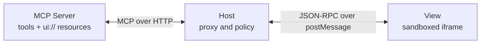
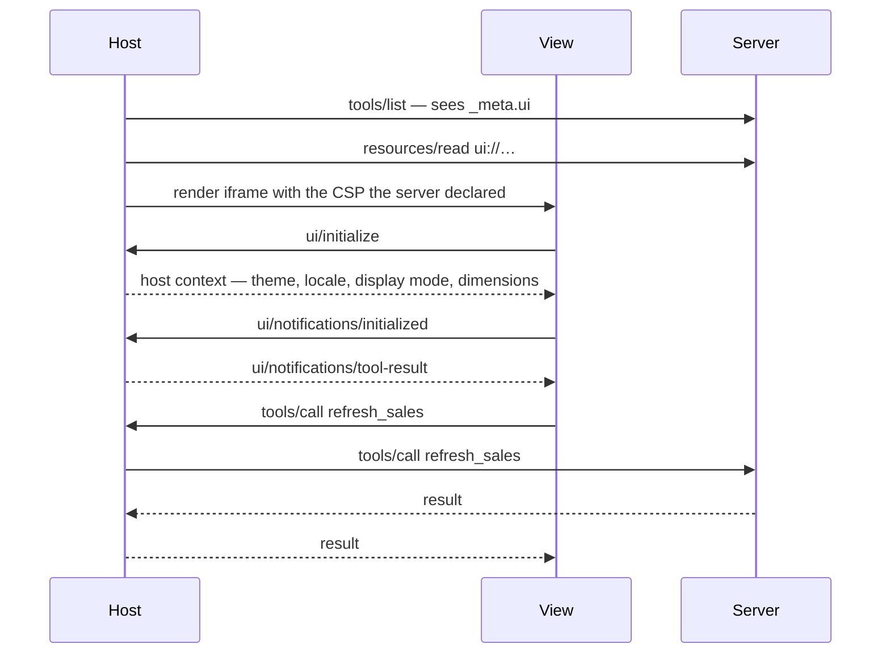

# 15. MCP Apps

A tool that ships a user interface, rendered by the host in a sandboxed iframe
([SEP-1865](https://github.com/modelcontextprotocol/modelcontextprotocol/pull/1865)).

## You leave able to

- Register the two halves of an app: a `ui://` resource and a tool that points at it
- Negotiate the `io.modelcontextprotocol/ui` extension on a protocol with no handshake
- Keep a UI-enabled tool working on a host that renders nothing
- Hide a tool from the model with `visibility: ["app"]`
- Read the CSP a host builds from what your server declared

## Run

```bash
pnpm example:15
```

No model key required. This prints the whole exchange a host performs before it
draws anything: negotiate, list, read the template, call the tool.

To watch it render:

```bash
pnpm example:15:host      # then open http://localhost:8100
```

## The two-part registration

An app is a resource and a tool, tied together by a URI.

```ts
server.registerTool('show_sales', {
  inputSchema: z.object({}),
  _meta: { ui: { resourceUri: 'ui://sales/dashboard.html' } },
}, handler);

server.registerResource('sales-dashboard', 'ui://sales/dashboard.html', {
  mimeType: 'text/html;profile=mcp-app',
}, async () => ({ contents: [{ uri, mimeType, text: html }] }));
```

Templates are declared up front, not returned with the result. That is what
lets a host fetch them at connect time, hash them, cache them, and review them
before any tool runs.

Nothing in [`server.ts`](server.ts) imports `@modelcontextprotocol/ext-apps`.
The extension is `_meta` on registrations the SDK already supports, so the v2
packages carry it unaided. Reach for the SDK when you want its `App` class and
React hooks in the View, not to register anything.

## Three entities



The View is an MCP client. The host is a proxy that decides what it forwards.
The server stays an ordinary MCP server and never learns an iframe exists.

## Lifecycle



The host sends nothing to the View before `initialized` arrives. Skip that and
your first `tool-result` lands on a page whose listeners are not attached yet.

## Negotiation, on a protocol with no handshake

**The published MCP Apps spec predates this revision.** Its capability
negotiation section shows an `initialize` request with
`protocolVersion: "2024-11-05"`, which `2026-07-28` removed. The mechanism is
unchanged; only where it travels moved.

The client declares the extension in its capabilities, and on this revision
capabilities ride the `_meta` envelope of every request:

```jsonc
"_meta": {
  "io.modelcontextprotocol/clientCapabilities": {
    "extensions": {
      "io.modelcontextprotocol/ui": { "mimeTypes": ["text/html;profile=mcp-app"] }
    }
  }
}
```

The server advertises the same key in the capabilities it returns from
`server/discover`. This is the path [module 14](../14-tasks) uses for tasks,
and it is what
[SEP-2133](https://github.com/modelcontextprotocol/modelcontextprotocol/pull/2133)
formalised for every extension.

## Progressive enhancement, and where the SDK puts it

The spec suggests registering a UI-enabled tool for hosts that support the
extension and a text-only variant for those that do not. **The v2 SDK cannot
do that at registration time.** `McpServerFactory` receives `era`, `authInfo`
and `requestInfo`, and no client capabilities, so the factory cannot see who is
calling. The decision moves into the handler, where the envelope is readable:

```ts
async (args, ctx) => {
  const capabilities = ctx.mcpReq.envelope?.[CLIENT_CAPABILITIES_META_KEY];
  const hostSupportsUi = Boolean(capabilities?.extensions?.['io.modelcontextprotocol/ui']);
  // …
}
```

In practice this costs you little, because the rule that matters is the same
either way: **a UI-enabled tool MUST return a meaningful `content` array**. The
model reads `content`, the View reads `structuredContent`, and stripping the UI
away leaves a tool that still works. Run the demo and watch the same call
answer a UI-capable client and a plain one identically.

## Tool visibility

```ts
_meta: { ui: { resourceUri: VIEW_URI, visibility: ['app'] } }
```

`["model", "app"]` is the default. `["app"]` gives you a tool the View can call
and the model never sees. Refresh buttons, pagination controls and form submits
stop appearing in `tools/list` for the agent, so they cost nothing in the
prompt. That is the same token argument [module 11](../11-headers-and-cache)
makes about stable, cacheable tool lists, arriving from the other direction.

The filtering is the host's job. Your server declares intent; a host that
ignores `visibility` shows the model everything.

## Security

Views run untrusted HTML from a server you may not control. The spec names five
threats: malicious HTML, sandbox escape, unauthorized tool execution, data
exfiltration, and phishing. Four mitigations, all of them the host's:

1. **A sandboxed iframe.** No access to the host's DOM, cookies or storage.
2. **Auditable communication.** Everything is JSON-RPC over `postMessage`, so a
   host can validate, log and refuse individual calls. [`host.ts`](host.ts)
   checks `event.source` before it reads a message.
3. **Predeclared templates.** Reviewed and hashed at connect time, before a
   tool runs.
4. **Restrictive-by-default CSP.** The host builds the policy from
   `_meta.ui.csp` alone. Declare nothing and the View reaches nothing,
   including `localhost` during development.

```ts
_meta: { ui: { csp: { connectDomains: ['https://api.example.com'], resourceDomains: [] } } }
```

`connectDomains` covers fetch, XHR and WebSocket. `resourceDomains` covers
scripts, styles, images and fonts. Both go in the `contents[]` entry your read
callback returns, not in the registration config.

One thing this demo skips: the spec requires a web host to wrap the View in a
**separate-origin sandbox proxy**. [`host.ts`](host.ts) uses
`sandbox="allow-scripts"` with `srcdoc`, which gives the View an opaque origin
and is enough to see the mechanism. A production web host needs the proxy.

## Host context and theming

At `ui/initialize` the host hands over theme, locale, timezone, display mode
(`inline`, `fullscreen` or `pip`), container dimensions and platform. It
re-notifies on change, so a View adapts without reloading. Hosts publish CSS
custom properties; always supply a fallback, because you are rendering inside
somebody else's design system:

```css
background: var(--color-background-primary, #fff);
```

## Try this

1. Run `pnpm example:15` and read the negotiation block. Then delete
   `capabilities` from the `connectWhenReady` call in [`client.ts`](client.ts)
   and watch the server log flip to "no, text only" while the answer stays
   useful.
2. Add `'https://example.com'` to `connectDomains`, restart, and watch the CSP
   printed by `pnpm example:15:host` change.
3. Give `show_sales` `visibility: ['app']` and confirm it disappears from what
   a model-facing host would list.

## Stretch

Add a second View for a `show_forecast` tool that shares the same
`refresh_sales`. Two tools, two templates, one app-only tool between them.

## If it breaks

| Symptom | Likely cause |
|---|---|
| The View renders but stays empty | The host sent `tool-result` before `ui/notifications/initialized` |
| Nothing loads in the iframe | The CSP has no `script-src` for what your page uses |
| A fetch inside the View fails silently | Its origin is not in `connectDomains`; CSP blocks and the browser console says so |
| The server reports "no UI support" | The client did not declare `extensions` in its capabilities |
| `tools/call` from the View hangs | The host is not forwarding it; check `event.source` and the method allowlist |

## Related

Extension negotiation: [14](../14-tasks). Tool-list token cost:
[11](../11-headers-and-cache). Threat model:
[docs/security.md](../../docs/security.md).

## Files

- [`server.ts`](server.ts): the two-part registration, and capability checking in the handler
- [`view.html`](view.html): the View, hand-rolled against `postMessage`
- [`client.ts`](client.ts): the protocol, with no browser
- [`host.ts`](host.ts): the optional host, iframe and proxy included
- [`constants.ts`](constants.ts)

---

**Spec**: [MCP Apps](https://github.com/modelcontextprotocol/ext-apps/blob/main/specification/2026-01-26/apps.mdx) ·
[quickstart](https://apps.extensions.modelcontextprotocol.io/api/documents/Quickstart.html) ·
[patterns](https://github.com/modelcontextprotocol/ext-apps/blob/main/docs/patterns.md)

[← 14, Tasks](../14-tasks) · [16, Testing →](../16-testing)

<!-- nav -->

---

Reference: [specification](https://modelcontextprotocol.io/specification/2026-07-28) ·
[schema](https://github.com/modelcontextprotocol/modelcontextprotocol/blob/main/schema/2026-07-28/schema.ts) ·
[migration](../../docs/migration.md) ·
[threats](../../docs/security.md) ·
[SDK notes](../../docs/sdk-notes.md)

[← 14, Tasks](../14-tasks) · [16, Testing →](../16-testing)
